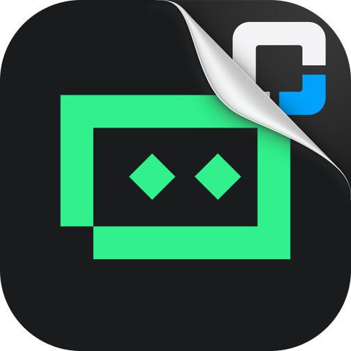

<p align="center">
  
</p>

<h1 align="center">OMC Trae OAuth</h1>

<p align="center">
  <a href="https://github.com/WizisCool/oh-my-cpa">
    <picture>
      <source media="(prefers-color-scheme: dark)" srcset="https://raw.githubusercontent.com/WizisCool/oh-my-cpa/main/web/src/assets/brand/omc-wordmark-dark.svg">
      
    </picture>
  </a>
</p>

<p align="center">
  Native Trae and Trae CN OAuth login for
  <a href="https://github.com/router-for-me/CLIProxyAPI">CLIProxyAPI</a>
</p>

<p align="center">
  <a href="https://github.com/omc-community/omc-trae-oauth/releases"></a>
  <a href="https://github.com/omc-community/omc-trae-oauth/actions/workflows/build.yml"></a>
  
  
</p>

<p align="center">
  <a href="README.md">English</a> · <a href="README.zh-CN.md">简体中文</a>
</p>

OMC Trae OAuth adds the `trae` provider to CLIProxyAPI. Sign in with a Trae or
Trae CN account from your panel's OAuth flow, and CPA gains model discovery from
Trae's own IDE catalogues, OpenAI-compatible execution with tool calls, and
normalized quota, with no separate process and no Trae desktop client.

The plugin is developed and maintained as part of the
[Oh-My-CPA](https://github.com/WizisCool/oh-my-cpa) ecosystem, the self-hosted
control plane and usage console for CLIProxyAPI.

> **Experimental.** The wire behaviour is ported from the MIT-licensed
> `packages/trae` plugin in `magpie-community/plugins`, whose Trae CN protocol was
> worked out from two open-source relays and whose international protocol was
> tried on one Free account in the SG region. This Go implementation has been
> checked offline against fakes and the native ABI, not against a live Trae
> account. Verify a sign-in and a chat against your own account before relying on
> a build, and report what you observe.

## Two portals, one provider

Trae accounts can sign in through two deployments. Both produce the same
credential (`"type": "trae"`) and share one executor, but they are separate
services on separate hosts, so the plugin registers two OAuth login entries
instead of one entry plus a site dropdown.

| Portal | Login entry | Sign-in page | Model host |
| --- | --- | --- | --- |
| Trae | `trae` | `https://www.trae.ai/authorization` | `coresg-normal.trae.ai` (SG), `coreva-normal.trae.ai` (US) |
| Trae CN | `trae-cn` | `https://www.trae.cn/authorization` | `trae-api-cn.mchost.guru` |

On a panel that renders per-entry metadata (CPA v8.0.51+) each entry appears as
its own card with its own name and logo. Loading the plugin needs **CPA v8.0.49+**,
which is where schema 10 first ships; the separate names and artwork need
v8.0.51+. On an older host both identifiers still work, and the panel shows the
plugin's own name and logo for them.

- Pick the portal by picking its entry. The entry wins over any `site` hint.
- Each credential records the portal that signed it in, as `site` and as the
  credential's `oauth_provider`.
- `site` (default `trae`) is only the fallback for a login request that names no
  entry, such as a host that starts a login under the plugin identifier alone.
- An explicit but invalid `site` value is rejected rather than silently resolved.

## Browser sign-in, no paste

Trae's authorization page finishes by sending the browser back to a callback on
`127.0.0.1`, carrying the account's Cloud-IDE-JWT, refresh token and identity. The
plugin starts that callback listener for the flow, stores what it receives beside
the auth material, and CPA's poll reads it. Nothing has to be pasted back.

The listener is bound to `127.0.0.1` on the CPA host. The browser that completes
the sign-in must therefore run on that host, or reach its loopback through a
forwarded port. A remote CPA deployment cannot complete this flow from a browser
on another machine, because Trae only sends the callback to loopback.

The device that signs in is created once and named to the authorization page, then
sent with every request. Trae drops requests that arrive on a new device each
time. Trae CN's device id has the 16-digit shape its clients use; the
international deployment keeps the 19 digits it was signed in with.

## Features

- Trae and Trae CN OAuth through Trae's own browser sign-in, one login entry per
  portal.
- Cloud-IDE-JWT refresh with single-use refresh tokens, sharing one in-flight
  exchange per credential. Trae CN renewals are first bound to the account's
  device with its P-256 key, as the IDE does, and fall back to the cloudide
  exchange when Trae refuses.
- Model discovery from the IDE's `batch_get_detail_param` list across every chat
  function, with the `__dev` and `__max` model names the list gives, Max-context
  variants, reasoning levels and image support. A shipped fallback list is used
  when the list cannot be read.
- OpenAI chat completions in and out, streaming and non-streaming, including
  native tool calls, tool calls written as text blocks, reasoning content, image
  inputs and token usage with prompt-cache counts.
- Normalized quota: Trae CN credits and the international deployment's dollar
  entitlements.
- Per-credential concurrency control.
- Import of existing `"type": "trae"` auth files.
- Error mapping that keeps a lapsed sign-in and a usage limit on their own
  status codes, retries a model through another chat function when Trae rejects
  the function, and folds everything else into a readable upstream failure. A usage
  limit also states how long it still runs when Trae sends `Retry-After`, so CPA
  rests the credential instead of retrying inside the window.

## Installation

Add this repository as a plugin-store source:

```yaml
plugins:
  enabled: true
  dir: /path/to/plugins
  store-sources:
    - https://raw.githubusercontent.com/omc-community/omc-plugins/main/official.json
  configs:
    omc-trae-oauth:
      enabled: true
```

Then install `omc-trae-oauth` from the plugin store and open its OAuth tile in
your panel. The store and shared-library name is `omc-trae-oauth`; the CPA
credential provider identifier remains `trae`. See
[docs/USAGE.md](docs/USAGE.md) for login, configuration, quota and
troubleshooting.

Releases are created by GitHub Actions whenever a `v*` tag is pushed.

## Configuration

| Field | Type | Default | Values |
| --- | --- | --- | --- |
| `site` | enum | `trae` | Fallback portal when a login request names no entry: `trae`, `trae-cn` |
| `max_concurrency` | integer | `3` | 1–100 requests per credential |
| `client_version` | string | `0.1.69` | TRAE SOLO build the model gateway is told it serves |
| `max_tokens` | integer | `32000` | Output budget used when the client names none, 1–1000000 |

## Development

The plugin implementation lives in [`go/`](go/). Tests run without network access
after modules are downloaded:

```sh
cd go
go mod download
GOPROXY=off GOSUMDB=off go test ./...
GOPROXY=off GOSUMDB=off go vet ./...
```

A local native build for the current machine:

```sh
cd go
CGO_ENABLED=1 go build -buildmode=c-shared -o ../build/omc-trae-oauth.so .
```

Use `.dylib` on macOS and `.dll` on Windows. `build/` is ignored by git.

The release workflow builds these artifacts from a tag:

```text
omc-trae-oauth_<version>_linux_amd64.zip
omc-trae-oauth_<version>_linux_arm64.zip
omc-trae-oauth_<version>_darwin_amd64.zip
omc-trae-oauth_<version>_darwin_arm64.zip
omc-trae-oauth_<version>_windows_amd64.zip
omc-trae-oauth_<version>_windows_arm64.zip
checksums.txt
omc-trae-oauth.omc.json
```

Each archive contains the correctly named `omc-trae-oauth.so`,
`omc-trae-oauth.dylib` or `omc-trae-oauth.dll` at its root. `checksums.txt`
covers every archive, and the plugin store verifies the archive it downloads
against it. `omc-trae-oauth.omc.json` is the optional description declaration
described in [docs/USAGE.md](docs/USAGE.md); the bytes it publishes are the same
bytes the plugin embeds and serves.

See [CONTRIBUTING.md](CONTRIBUTING.md) for commit conventions, test expectations,
and ecosystem development standards.

## Project layout

```text
assets/logo.png         Plugin sticker: the plugin's face in a store
assets/trae.svg         Trae's monochrome mark for the Trae entry
assets/trae-color.svg   Trae CN's green mark for the Trae CN entry
go/                     Go/cgo plugin implementation and tests
go/assets/              Embedded artwork and the omc.json declaration
docs/USAGE.md           Operator installation and usage guide
```

The Go implementation is independent. Protocol provenance, including the browser
sign-in and the device-bound renewal, is recorded in [NOTICE.md](NOTICE.md).

## License

[MIT](LICENSE)
